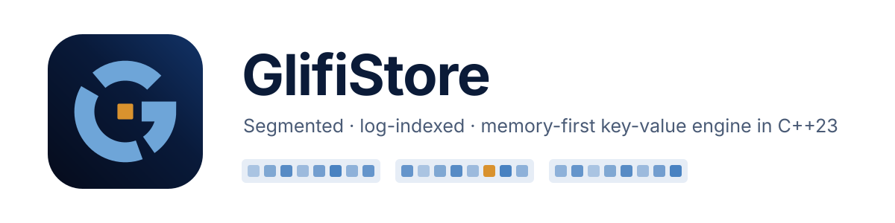

<p align="center">
  <picture>
    <source media="(prefers-color-scheme: dark)" srcset="docs/assets/glifistore-banner-dark.svg">
    
  </picture>
</p>

<p align="center">
  <a href="https://github.com/gipidevdor/GlifiStore/actions/workflows/ci.yml"></a>
  <a href="#status"></a>
  <a href="LICENSE"></a>
</p>

GlifiStore keeps opaque binary keys and values in one key-space. Every key belongs to one shard
pair, a Reader and a serial Writer. The Writer appends immutable Records to fixed 64 MiB Segments,
and an exact-key Index points to the latest visible Record. Embed the engine through the C++ API or
the C ABI, or run the `glifistored` daemon over wire protocol v2.

It is a key-value engine, not a SQL or document database: no joins, no generic secondary indexes,
no unbounded ordered scans. Engine throughput is not application throughput; read
[where performance matters](docs/architecture/where-performance-matters.md) before equating them.

## Status

> [!IMPORTANT]
> **Architectural prototype, version 0.1.0. Not production ready.**
> Volatile storage, persistence v1, recovery, compaction, the paired daemon, secure transport, the
> C ABI v1 implementation and six native clients exist and are tested. Still open: the first
> retained cross-release C ABI proof, stable compatibility between product releases, power-loss
> certification on any filesystem or device, signed published artifacts and a full production
> evidence matrix.
>
> Readiness is decided by the [quality gates](docs/production-readiness.md), derived from the
> machine-readable [assurance catalog](engineering/README.md), never by the presence of a feature.
> Contributor and agent rules: [AGENTS.md](AGENTS.md).

## How it works

```text
PUT, ERASE   key ──> owner pair: Reader ──> SPSC lane ──> Writer ──> append Record, publish
GET          key ──> owner pair: Reader ──> ReadGeneration ──> Record ──> value
```

- **One owner per key.** Routing maps every key to one shard pair: a Reader that runs the event
  loop and a serial Writer. After `INIT`, a connection binds to one owner and the daemon hands its
  socket and buffered state to that Reader exactly once. A request for another owner returns
  `WRONG_OWNER` and is never forwarded.
- **Writes** leave the Reader through a bounded SPSC lane to the owner's Writer.
- **Reads** use the Reader's immutable `ReadGeneration`, adopted once per event-loop turn.
- **Names.** `--shard-pairs` sets the pair count. Persistence and wire v2 keep the name
  `worker_count` for it; `--workers` is its deprecated 0.1.x alias.

`glifistored` has one runtime, paired Reader–Writer shards
([ADR 0031](docs/adr/paired-reader-writer-shards.md)): non-blocking `epoll` or `kqueue`,
owner-bound connections, bounded queues, graceful drain and background maintenance. The former
volatile TCP prototype is removed from the tree; the ADR 0036 generation-publication laboratory
remains under `src/experimental/`, built for tests and benchmarks, never installed and unreachable
from `glifistored`.

Authority: [architecture specification](docs/spec/architecture.md) ·
[server model](docs/architecture/server-model.md) · [persistence v1](docs/spec/persistence-v1.md).

## Build

On macOS:

```bash
./scripts/bootstrap-macos.sh   # repository-local CMake and Ninja
./scripts/dev.sh test          # configure, build and run CTest
```

On Linux and BSD, with CMake 3.25 or newer, a C++23 compiler and Ninja:

```bash
cmake --preset unix-debug
cmake --build --preset unix-debug
ctest --preset unix-debug
```

`macos-release` and `unix-release` build optimized binaries; `./scripts/dev.sh help` lists
sanitizers, fuzzing and benchmarks. Details: [development](docs/development/README.md) and
[macOS and Xcode](docs/development/macos.md).

## Run

```bash
./build/macos-debug/glifistored --bind 127.0.0.1 --port 7379 --shard-pairs 4
```

This serves cleartext on loopback with volatile storage; on Linux and BSD the binary is under
`build/unix-*`. Durability is always explicit:

```bash
./build/macos-release/glifistored --profile production \
  --data-dir /private/path/to/glifistore --bind 127.0.0.1 --port 7379
```

`--dump-config` prints every resolved setting without opening a Store or a listener. Flags,
profiles, limits, TLS, signals and exit codes are in the [CLI reference](docs/cli.md); deployment,
backup and recovery in [operations](docs/operations/README.md).

## Durability

| Mode (C++ / CLI) | A successful mutation is acknowledged when |
| --- | --- |
| `volatile_memory` / `volatile` | it is visible in memory; nothing survives a restart |
| `durable_sync` / `durable-sync` | its Record and commit slot have crossed an ordered durability boundary |
| `durable_group` / `durable-group` | the same strict boundary is reached, shared by a bounded group |
| `durable_periodic` / `durable-periodic` | it is accepted before the next periodic boundary; the loss window is bounded |

Every durable mode uses persistence v1: versioned Manifest, Segment, Record and commit-slot formats,
bounded recovery and fail-closed validation, with no alternate format and no automatic migration.
Resource limits and maintenance policy are runtime settings, not format. Reopening uses the
persisted Worker topology and routing state.

> [!WARNING]
> Durable mode is **not certified** on any filesystem or device. NFS, SMB, FUSE, overlay and other
> remote or user-space filesystems are unsupported. Process-kill and syscall-fault tests do not
> replace reviewed power-loss evidence.

Contracts: [public C++ API](docs/reference/cpp-api.md) ·
[durability and recovery](docs/architecture/durability-recovery.md) ·
[platform evidence](docs/architecture/platform-durability-evidence.md).

## Interfaces

**C++ API.** The embedded Store offers GET, PUT, PUT batch, ERASE, ERASE batch, TTL, flush, fenced
online backup and explicit compaction, with volatile storage and the three durable policies. It
stays unstable before 1.0. [Reference](docs/reference/cpp-api.md).

**C ABI v1.** A shared library (`GlifiStore::abi`, `pkg-config glifistore-abi`), deliberately
smaller than the C++ API: version and status, open and close, owning GET, PUT, PUT batch, ERASE and
ERASE batch, with volatile and `durable-sync` storage only. An ABI contract does not raise the
product above architectural prototype. [Specification](docs/spec/c-abi-v1.md) ·
[guide](docs/abi/README.md).

**Wire protocol v2.** `INIT`, `BIND_WORKER`, `PING`, `GET`, `PUT`, `ERASE`, `BACKUP`, `HEALTH`,
`READY` and `STATS`. [Specification](docs/spec/wire-protocol-v2.md).

**Large values, opt-in and embedded only.** A new durable paired Store with
`StoreConfig::enable_blobs = true` accepts values up to 64 MiB in single-item `put`, `get` and
`erase`, and streams them through `begin_blob_put` and `open_blob`. Blob files are immutable; typed
references use an explicit persistence v2 profile, and existing v1 Stores are not upgraded. Daemon,
SDK and C ABI support are deferred; default persistence v1, wire v2 and the claim ceiling are
unchanged. [Large blob storage v1](docs/spec/large-blob-storage-v1.md) and its open
[gates](engineering/gates/large-blobs.yaml).

## Clients

Six official clients share one fixture set and one
[client-semantics contract](docs/spec/client-semantics-v1.md): default FNV wire-v2 routing,
monotonic deadlines, bounded ordered pipelines and the portable `committed` / `rejected` /
`indeterminate` mutation outcome. A pipeline belongs to one Worker; batch APIs group by Worker and
restore the caller's order. **A batch is not a transaction.**

| Language | Package | Concurrency |
| --- | --- | --- |
| [C++](docs/reference/cpp-client-api.md) | Installable `GlifiStore::client` | Thread-safe Worker connections; pipeline and batch |
| [Python](sdk/python/README.md) | Standard-library sync and `asyncio` | Thread-safe sync client; native async client |
| [Perl](sdk/perl/README.md) | Synchronous, binary-safe | One client per process or thread; per-Worker pipelines in one select loop |
| [Go](sdk/go/README.md) | Synchronous native module | Mutex per Worker; batch fan-out with goroutines |
| [Erlang](sdk/erlang/README.md) | OTP application | Shareable coordinator; one `gen_server` per Worker |
| [Ruby](sdk/ruby/README.md) | Synchronous and optional `async` | MRI-thread-safe sync client; Fiber-aware async client |

Keyed SipHash-2-4 routing ([ADR 0030](docs/adr/0030-keyed-worker-routing.md)) is selected by the
extended `INIT` identity and implemented by the daemon and every official SDK; plain
`GlifiStore/2` keeps FNV-1a. The packages live in this tree and are not yet promised in every
language registry ([SDK roadmap](docs/architecture/sdk-roadmap.md)).

```bash
./scripts/test-sdk-interop.sh
./scripts/test-secure-profile-interop.sh   # mTLS, authorization, keyed routing, prefixes, CRL, quotas
```

CI runs the secure-profile smoke for C++, Python and Go, and for Perl, Ruby and Erlang when their
toolchains are present.

## Verify

```bash
./scripts/dev.sh test        # CTest
./scripts/dev.sh asan        # AddressSanitizer and UBSan
./scripts/dev.sh tsan        # ThreadSanitizer
./scripts/dev.sh verify      # formatting, scripts, documentation and assurance checks
./scripts/dev.sh benchmark-server --workers 4 --clients 4 --pipeline 32 \
  --executor-affinity --warmup 1 --repeats 5
```

Benchmarks validate every response and report throughput; selected harnesses add latency, traffic
and memory. Hosted-runner results are regression signals, not product claims: a publishable
comparison needs identical code, workload, routing, durability, dataset, hardware, affinity and
measurement rules, as the [benchmark standard](docs/spec/benchmark-standard.md) defines. Raw local
output is gitignored.

A promise holds only as the conjunction of a requirement, a specification, an implementation,
automated proofs, retained evidence and a stated residual risk
([engineering baseline](docs/assurance/engineering-baseline.md)).

## Documentation

The [documentation map](docs/README.md) lists every page. To begin:

| To | Read |
| --- | --- |
| understand the system | [Architecture specification](docs/spec/architecture.md) · [code tour](docs/development/code-tour.md) · [glossary](docs/glossary.md) |
| embed the Store | [Public C++ API](docs/reference/cpp-api.md) · [C ABI](docs/abi/README.md) |
| write a client | [Wire protocol v2](docs/spec/wire-protocol-v2.md) · [client semantics v1](docs/spec/client-semantics-v1.md) |
| operate the daemon | [Operations](docs/operations/README.md) · [CLI reference](docs/cli.md) |
| judge durability | [Persistence v1](docs/spec/persistence-v1.md) · [platform evidence](docs/architecture/platform-durability-evidence.md) |
| review security | [Secure profile](docs/security/secure-profile.md) · [threat model](docs/security/threat-model.md) |
| judge readiness | [Quality gates](docs/production-readiness.md) · [assurance catalog](engineering/README.md) |
| contribute | [Contributing](CONTRIBUTING.md) · [code style](docs/development/code-style.md) · [test strategy](docs/development/test-strategy.md) |

The C++ reference is generated with Doxygen ([how](docs/development/documentation.md)). Installed
builds ship mdoc manuals: `man 8 glifistored`, `man 7 glifistore` and the section-1 tools
([man/](man/README.md)).

## Platforms

macOS on Apple Silicon is the primary development platform; macOS on Intel remains a target. Linux
(x86-64 and Arm64), FreeBSD and OpenBSD with LibreSSL have build and test workflows. Hosted runners
and BSD virtual machines are portability and regression evidence, not durability certification: no
platform or filesystem row is E3/E4 power-loss certified.

## Security

Cleartext on loopback is the development default. The daemon offers TLS 1.3 and mTLS, capability
and key-prefix authorization, quotas, audit events, CRL checks and Unix-socket peer credentials; its
secure profile requires TLS 1.3, mTLS and a default-deny authorization map. Every official SDK
implements TLS, mTLS and the extended `INIT` identity, subject to its runtime's TLS support. None of
this certifies hostile public or multi-tenant deployment. Report vulnerabilities as described in
[SECURITY.md](SECURITY.md); manage certificates and revocation with the
[certificate runbook](docs/operations/secure-profile-certs.md).

## License

BSD-3-Clause: [LICENSE](LICENSE), [NOTICE](NOTICE),
[third-party notices](THIRD_PARTY_NOTICES.md) and the [licensing policy](docs/legal/licensing.md).

*Glifo* is a mark carved into a surface; a store is durable, addressable memory. The logo is a `G`
of three immutable Segment plates around one copper Record: a mark that persists
([artwork](artwork/README.md)).
