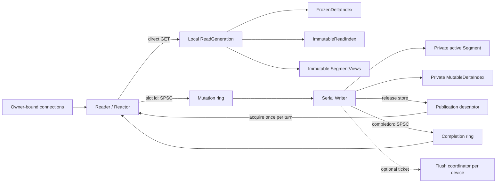
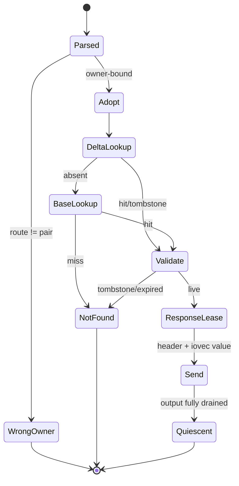
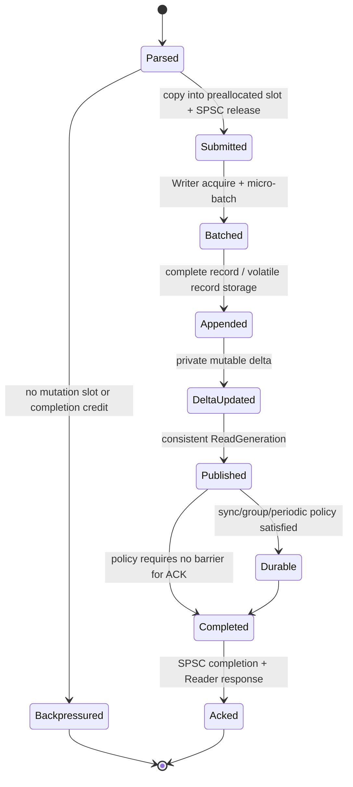

# ADR 0031: Paired Reader–Writer shards

- Status: accepted (product concurrency for `glifistored`; amended for embedded Store by 0032)
- Date: 2026-07-28
- Deciders: project owner, storage, networking, performance and reliability maintainers
- Applies to: paired runtime; persistence v1 and wire protocol v2 remain unchanged
- Amends: ADR 0005, 0012, 0016, 0018, 0023 and 0030
- Amended by: [ADR 0032](0032-paired-concurrency-embedded-store.md) (paired concurrency becomes the
  default for embedded `Store` as well as the daemon; supersedes Worker-mutex as product default);
  [ADR 0037](0037-shard-execution-token-flat-combining.md) (Writer = per-shard execution token;
  embedded sync may omit a dedicated Writer thread; daemon keeps a dedicated executor)
- Supersedes: the Worker-affine / mutex-on-the-Index model as the product default (completed with
  ADR 0032); does not supersede persistence v1 or wire v2

## Context

The current daemon combines an owner-affine Reactor with the data path of a Worker, but GET and
mutations still share mutable structures and synchronization in the `Store`. Durable mutations leave
the Reactor through bounded MPSC lanes and return through MPSC completion queues. This avoids
blocking I/O in the Reactor, but it does not make GET independent of mutation of the same shard, and
it keeps owning tasks, admission mutexes and multiple producers per lane.

The new unit of ownership is a mandatory pair with one Reader/Reactor and one serial Writer. The
Reader must read exclusively local immutable state; the Writer must be the only mutator. The
decision is a migration of the runtime, not a change to the persistent bytes.

## Decision drivers

- owner-bound GET without mutexes, queues, a global catalog or the Writer;
- a single mutator and only two SPSC transfers per pair;
- stable GET p99/p99.9 during write bursts, rotation and compaction;
- memory, queueing, publication delay and reclamation strictly bounded;
- routing seed, persistence v1, fail-closed recovery and outcome classification unchanged;
- no atomic refcount, allocation or ambiguous ownership per GET;
- measurable topology on Linux NUMA, BSD/macOS and Apple Silicon.

## Decision

The paired runtime will have exactly `N` independent domains:

```cpp
class ShardPair final {
  public:
    ReaderWorker reader;
    WriterWorker writer;
    ReadPublication publication;
    MutationQueue mutations;
    CompletionQueue completions;
};
```

The following always hold:

```text
reader_count == writer_count == shard_pair_count
pair_id == persisted owner_worker id
route = hash_key_routing(key, persisted_seed) % shard_pair_count
```

There are no global readers or writers, cross-pair lookups, fallback to peers, online migration in
the data path or repeated forwarding. The connection binding remains unique: the pair's Reader is
its Reactor and the sole owner of the socket.

### Architecture diagram



### Ownership map

| State | Exclusive owner | Access by the other side |
|---|---|---|
| socket, parser, connection slot, output lease | Reader | none |
| free/completed mutation slot | Reader | Writer only after dequeue and before the completion |
| submitted mutation slot | Writer | Reader does not touch it |
| active Segment, append cursor, sequence, batch | Writer | never |
| `MutableDeltaIndex` | Writer | never |
| published `ReadGeneration` | immutable | Reader reads; Writer may only retire it after quiescence |
| published `SegmentView` | immutable | Reader reads within `visible_extent` |
| routing and pair topology | immutable after startup | both read |
| manifest/intent | persistence kernel | never in the normal GET |

The transfer of a slot is linear: `FreeReader → SubmittedWriter → CompletedReader → FreeReader`. No
reference taken from the slot may outlive the next transfer of ownership.

## GET path and state machine



The Reader adopts at most one publication per event-loop turn, so every GET uses a single local
`ReadGeneration*`. The lookup tries the delta first and then the base: at most two lookups. TTL does
not modify the Index on GET; an expired record is semantically absent and reclaim is
Writer/maintenance work. The normal GET uses no Writer, ring, thread pool, mutex, condition
variable, manifest, catalog or shared allocator.

For values sent scatter/gather, the connection slot holds a Reader-local epoch lease until the last
byte has been written. The Reader publishes quiescence only beyond the minimum epoch still
referenced by its response leases. No atomic increment/decrement per GET is needed.

## PUT/ERASE path and state machine



The ACK never precedes the publication containing the mutation. In sync/group mode it does not
precede the corresponding durable boundary either. A disconnect after submission does not cancel the
mutation; the generationally stale completion is discarded and the client retains an indeterminate
outcome.

### `accepted`, `visible` and `durable` frontiers

| Frontier | Meaning | Advancement |
|---|---|---|
| `accepted_through` | mutation slot transferred to the Writer | in-order SPSC dequeue |
| `visible_through` | included in the current publication | release-store of the descriptor |
| `durable_through` | included in the completed persistent boundary | successful v1 commit/flush |

`durable_through <= visible_through <= accepted_through`. The counters are Writer-local, monotonic
sequences and are not used as substitutes for the publication descriptor.

Order per policy:

| Mode | Order before the ACK |
|---|---|
| volatile | complete append → delta → publication → completion |
| durable-periodic | append/slot according to the periodic contract → publication → completion; durability may follow |
| durable-sync | append → sync record → commit slot → sync → publication → completion |
| durable-group | append batch → barrier/commit batch → publication batch → completions |

The first implementation favors commit-before-publication for sync/group, reusing the v1 contract. A
future publication-before-durability is permitted only for a policy that already allows a
non-durable ACK and with a recovery that treats the generation as derived state, never as persistent
authority.

## Queues and backpressure

Each pair has exactly one SPSC mutation ring and one SPSC completion ring. Power-of-two capacity,
preallocated storage, producer/consumer indices on 128-byte lines and a trivial/compactly movable
payload. The rings carry slot identifiers, not `std::string`, `std::vector`, callbacks, `RecordRef`,
file handles or smart pointers.

The Reader owns a fixed pool of mutation slots with bounded key/value areas. Before submit it
reserves slot, byte budget and a completion credit together. Therefore every accepted mutation
already has guaranteed space in the completion ring. A full completion ring is not ordinary
overload: it violates an invariant and makes the pair fail-closed; it cannot cause a drop or an
unbounded spin.

When capacity is lacking, the Reader temporarily disarms the read interest of the affected socket or
applies admission control. The profile may choose an immediate reject or a measured bounded spin,
but the default is socket backpressure; `park` is permitted only outside the Reactor. No ring grows.

Minimum memory ordering:

- the producer writes the cell/slot completely, then publishes `head` with release;
- the consumer observes `head` with acquire before reading;
- the consumer finishes its use, then publishes `tail` with release;
- the producer observes `tail` with acquire before reuse;
- local indices and non-publishing metrics use relaxed.

## Two-level Index

`ImmutableReadIndex` contains no construction tombstones, resize or write metadata. The Base uses
compact records of at most 64 B, inline keys up to 16 B, an arena for long keys and deduplicated
Segment generation pins; the control bytes stay contiguous for each SIMD group. The paged frozen
delta contains the most recent override or a tombstone and is modified only through a Writer-owned
copy-on-write builder. The pages hold pointers to immutable 64 B cells allocated in Writer-owned
append-only blocks; long keys and Segment/file generation pins have a stable address in the arena.
There is no longer a `shared_ptr` control block per version.

No chain of deltas is created. During an incremental merge:

1. the readable generation remains `Base B + Frozen Dcut`;
2. the Writer builds `B' = merge(B, Dcut)` in quanta;
3. new writes accumulate in a private post-cut delta;
4. until `B'` is ready, a publication uses a new bounded cumulative delta relative to `B`;
5. once `B'` is verified, the Writer publishes `B' + Frozen Dpost` in a single descriptor.

Hard thresholds on entries, versions and bytes prevent unbounded growth. The merge also starts when
repeated overwrites reach the version threshold even though they leave a single logical key. If the
merge does not keep pace, the pair applies backpressure to writes; it does not add a third level.

The initial production configuration starts the merge at 8,192 entries, limits the post-cut to
32,736 entries, limits the overall delta to 40,960 entries and processes 4,096 slots per Writer
turn. The quantum also counts empty slots, so the work of each invocation is bounded. The new base
allocates pages only while live records are being visited; the initial directory is proportional to
one entry every 65,536 slots. Every post-cut mutation is inserted both into the cumulative delta
still visible relative to `B` and into `Dpost`. The capacity check happens before the Store
mutation: delta exhaustion or retire pressure produces backpressure, never an unpublishable
mutation. A durable refresh from rotation/compaction atomically replaces the snapshot and cancels
the merge in progress; the cut remains pinning-safe until the Writer-private state is destroyed.

## Publication protocol

Two independent atomics, `epoch` and `generation`, are not used. `epoch` and `visible_through` are
fields of the same immutable generation published by the Writer:

```cpp
struct ReadGeneration final {
    std::uint64_t epoch;
    std::uint64_t visible_through;
    // Immutable base, delta and pins.
};

std::atomic<const ReadGeneration*> current;
```

The Writer initializes the generation, index, segment view and descriptor, then performs a single
`current.store(next, std::memory_order_release)`. Once per turn the Reader performs
`current.load(std::memory_order_acquire)` and adopts pointer and epoch from the same object. It is
not possible to observe a new epoch and an old generation. The generation and the whole reachable
graph are immutable after the store.

## Reclamation protocol

The production runtime uses a single, conservative QSBR epoch frontier:

1. the Writer publishes epoch `N` and enqueues the old descriptor in the bounded retire list;
2. the Reader adopts `N` once per turn and registers every asynchronous cold I/O with its own epoch;
3. the Reader publishes `min(adopted epoch, minimum lease epoch)` as `reader_safe_epoch`;
4. the Writer frees only descriptors with `retired_epoch < reader_safe_epoch`;
5. the cold completion already contains an owning value, so the Reader may release the I/O lease
   before enqueuing the response;
6. shutdown forces the drain of the leases before the Writer and the Store stop.

The Reader-private tracker has 65 preallocated cells: the retire list is limited to 64 generations
plus the current one. A cold task borrows key storage, `RecordRef` and the file-generation pointer
from the generation only after establishing this frontier; it performs no atomic refcounts per
request. A closed connection cancels the I/O but does not release the lease early. A full retire
list or tracker applies backpressure and never forces the free.

The publication admission decision is one and the same for all Writer paths. After a reclaim
attempt, the dedicated Writer and the combiner check, **before entering the Store**, both the limit
of 64 retired generations and the capacity of the post-cut delta for the entire batch. This applies
to sync, async and batch durable mutations; at the limit the outcome is `resource_exhausted`,
known-not-committed. Refresh and merge completion must also hold the same retire capacity before
replacing the current generation. There is no housekeeping path that can exceed the bound.

Publication of the Reader frontier makes reclaim *admissible*, but does not promise an immediately
observable idle transition. Reclaim is opportunistic on the Writer's next turn; a new mutation
performs it before its own admission decision. The contractual liveness property is therefore
bounded resumption at the next Writer turn, not polling of the retire counter down to zero in the
absence of work.

Every actual installation of the generation also repeats the limit check in the same common helper.
It is an invariant guard, not a second admission: a violation terminates the process because
continuing could make memory unbounded or produce ACKs for a non-adoptable authority. The branch is
`[[unlikely]]`, Writer-local and free of locks/atomics; the local diagnostic A/B is retained in
`benchmarks/results/generation-retire-install-guard-2026-08-27/`.

The current scatter response owns an `OwnedValue` and does not retain an `Index` slot, `RecordRef`
or Segment pin: it may therefore release the task's QSBR lease before the socket drain. A future
`get-into` that exposed iovecs borrowed from the generation should instead extend the same frontier
up to the final short write; it will not be able to publish quiescence while those references are
live.

## Segment and compaction

The active Segment and its metadata are Writer-private. A publication exposes immutable
`SegmentView`s with identity, generation pin and `visible_extent`; bytes below that extent are
complete and are no longer modified. Rotation publishes a new view without invalidating the previous
one.

Compaction builds and verifies a subsequent generation in copy quanta. The Reader continues on G;
G+1 is published atomically and G is retired only after QSBR. Intent and Manifest remain the only
crash-safe authorities. Copy, checksum and file I/O do not happen in the Reader and do not block the
current publication. Reclaim debt, rate limit, capacity bypass and p99 guard remain per pair.

## Writer micro-batching

Each Writer closes the batch on the first of: record count, byte count, deadline, durability
boundary, queue pressure and publication urgency. With an empty queue it does not introduce an
artificial wait. Profiles configure only thresholds, affinity and budgets; they do not change
ordering, visibility or failure semantics.

## Topology and profiles

Reader and Writer use distinct but nearby physical cores, preferably in the same NUMA node/LLC.
Sibling SMT is a benchmark variant, not the maximum-performance default. Linux uses affinity on the
allowed cpuset and first-touch allocation; macOS uses affinity tag/QoS and declares the result
advisory. Apple Silicon prefers P-cores when the available API allows it without a false promise of
hard pinning.

Initial profiles: `balanced`, `read_optimized`, `write_optimized`, `maximum_performance` and
`memory_constrained`. Each profile produces an observable effective configuration.

## Shutdown protocol

```text
stop listener and new admission
→ Reader disarms socket read for new mutations
→ drain mutation ring
→ Writer closes batch and classifies every mutation
→ required commit/flush
→ publish the last necessary ReadGeneration
→ drain completion ring
→ Reader sends ACKs already admitted or closes with an explicit outcome at the deadline
→ drain output leases and cold I/O, then terminate the Reactors
→ stop and join the Writers
→ stop and join the disk-read executor
→ Store::close stops admission and maintenance, then waits for Store operations
→ internal Reader finalization: publication=null and terminal safe frontier
→ release of all generations, including the final Writer one
→ close Segments and durable runtime
```

Accepted mutation slots are not lost. Drain expiry may reject only slots not yet transferred to the
Writer; after dequeue the operation must complete with `committed`, `not_committed` or
`indeterminate`.

Reader finalization is separate from `stop_and_drain` but belongs to `Store::close`: it succeeds
only after admission is closed, the Writers are joined, Store operations are drained and maintenance
is joined. In the daemon, Reactor and cold I/O have already terminated before close is entered. It
first validates all pairs; a counted `ReadLease` that is still active produces `unavailable` without
partial finalizations. The transition is idempotent, prevents later adoptions and frees every
generation while keeping epoch and scalar counters for post-stop observability. It does not move any
ACK point or durability boundary.

## Failure matrix

| Failure | Action | Client outcome / state |
|---|---|---|
| mutation queue full | socket backpressure or reject policy | `overloaded`, not accepted |
| completion credit absent | no submit | `overloaded`, not accepted |
| completion ring full with credit | fail-close pair/process | invariant violation; never drop |
| allocation before submit | no transfer | `resource_exhausted`, not committed |
| append/rotation before commit | do not publish the batch | not committed if proven, otherwise indeterminate |
| commit EIO/ENOSPC | do not ACK success; fail-close if authority is uncertain | v1 classification unchanged |
| crash append→publication | recovery uses only Manifest/commit v1 | RAM generation ignored |
| crash publication→periodic durability | visibility lost at restart, allowed by the policy | ACK according to periodic |
| publication build failure before the mutation | current generation remains authoritative | batch not accepted |
| publication build failure after commit/mutation | sticky fail-close | no success ACK; client outcome indeterminate |
| merge quantum allocation failure | cancel the builder, keep `B + D` | bounded retry after progress or backpressure |
| Writer terminates unexpectedly | pair unavailable, stop admission | no silent loss |
| Reader terminates unexpectedly | Writer drains/classifies accepted slots | socket outcome indeterminate if already accepted |
| shutdown during batch | early close of the batch | normal classification |
| retire backlog full | shared pre-Store decision suspends every sync, async and batch publication/mutation | `resource_exhausted`, known not committed; bounded backpressure |
| install generation beyond retire bound | internal violation impossible after valid admission | fail-fast termination; no silent overflow/ACK |
| incomplete generation at recovery | not a persistent authority | ignored; fail-closed recovery on v1 bytes only |

## Observability

Each per-pair snapshot includes at least: pair/CPU id, reader/writer operations, GET hit/miss,
reader/writer epoch, accepted/visible/durable through, base/delta entry, publication
count/record/byte/latency, depth/high-water/full of the two rings, batch size/wait, Reader/Writer
stall, generation retire count/delay, `generation_admission_backpressure_total` and minimum
response-lease epoch. The metrics do not publish correctness and use relaxed or owner-local
snapshots.

The runtime also exposes `read_merge_active`, `read_merge_post_entries`, `read_merge_starts`,
`read_merge_completions`, `read_merge_failures`, `read_merge_backpressure` and
`read_merge_slots_processed`, both per pair and in the STATS aggregate.

## Benchmark plan and acceptance criteria

The A/B comparison uses the same data revision, routing seed, hardware, build and client, with
interleaved old/new runs. Minimum matrix:

- GET/PUT mix: 100/0, 99/1, 95/5, 90/10;
- working set: L2, LLC, beyond LLC; uniform, Zipf and hot key;
- value: 64 B, 1 KiB, 64 KiB, 256 KiB;
- pipeline: 1, 8, 32, 128; one and multiple connections per pair;
- write: volatile/sync/group/periodic; batch 1, 4, 16, 32, 128; queue saturation;
- overlap: burst, read-after-write, rotation, incremental compaction;
- scale: 1, 2, 4, 8 pairs within the physical cores, without oversubscription in the baseline.

The following are recorded: throughput, p50/p95/p99/p99.9, queue/publication/commit delay, CPU, IPC,
branch/cache/LLC/dTLB miss, context switch, migration, syscall, copies, allocations, RSS, generation
and reclaim delay. Linux uses `perf stat/record`; macOS uses Instruments and `powermetrics` when
authorized. Raw results go in `benchmark-results/paired-shards/<commit>/<platform>/`.

Mandatory gates: owner-bound GET demonstrated without mutex/queue; better p99 under concurrent
writes; scalability with pairs; read-after-write; bounded memory/queue; sanitizer, fuzz, fault and
crash tests; no loss at shutdown. Average throughput alone does not close the gate.

## Migration plan and backlog

1. **Design:** this ADR, paired memory model, state/failure machine and A/B harness.
2. **Confined volatile prototype:** one pair not connected to the daemon, SPSC rings, slot pool,
   immutable generation and read-after-write/backpressure tests.
3. **Multi-pair:** persisted routing, Reactor ownership, affinity, metrics and scaling.
4. **Durability:** Segment v1, sync/group/periodic, rotation and fault classification.
5. **Compaction/reclamation:** QSBR, retirement, incremental merge and Manifest transition.
6. **Reader optimization:** `ImmutableReadIndex`, SIMD, scatter/gather, get-into, batch lookup and
   PGO.

For GlifiStore 0.1.0 the paired runtime is the only target model and becomes the default as soon as
the first production gate preserves the wire/persistence suite. The previous runtime remains
temporarily in the repository as an A/B oracle, recovery compatibility harness and source of already
verified components; it receives no new architectural choices and does not constitute a second
supported model for the same key.

Promotion happens in always-compilable tranches: production SPSC Writer lane, GET publication,
durability parity, then removal of the legacy routing. During the transition a tranche may reuse
Store/persistence v1 behind the paired Writer, but may not execute a mutation directly in the
Reader. No tranche may change the v1 bytes or reduce recovery, shutdown and outcome classification.
Changing the pair count remains an offline migration (ADR 0024).

The first TCP gate of 2026-07-28 had shown a regression on small group mutations because the serial
Writer closed one-record batches. The subsequent Writer-owned batching restored multi-record batches
without reintroducing concurrent mutators; throughput and tail latency remain gates, not a reason to
keep evolving the previous runtime.

### 0.1.0 migration status

The first production cut routes every `PUT` and `ERASE`, volatile or durable, from the
Reader/Reactor to the shard's only Writer. Mutation and completion lanes are bounded SPSC,
preallocated and cache-line separated; the normal queue path uses no mutex, condition variable or
CAS. The atomic admission gate linearizes `submit` with `stop`, so the Writer cannot exit between an
empty-queue check and a concurrent publication. `--shard-pairs` is the canonical name; `--workers`
remains an alias. The old `--durable-group-concurrency` has been removed: the single Writer per
shard is not configurable.

In `durable_group` the Writer extracts a bounded micro-batch from the SPSC, prepares all Records in
FIFO order and closes a single commit before publishing results and completions. The staging of
publications is owned by the Worker, not by the callers' stack frames; a durable sequence watermark
also wakes concurrent legacy Store callers without retaining borrowed pointers. `min_records` uses
the explicit deadline, while the burst beyond the minimum uses a short, bounded window. No ACK is
produced before the commit and the publication of the entire sub-batch.

The production GET now uses an immutable `ReadGeneration` adopted once per turn: a paged
copy-on-write Swiss delta, a read-only base and at most two lookups. In volatile mode every entry
holds the exact pin `RecordRef + SegmentPtr`; in durable mode it holds
`RecordRef + RuntimeSegmentGeneration`, that is, the read-only file descriptor of the precise
generation. The durable base is built directly from the recovered Index without I/O under lock;
every PUT adds to the delta the pin captured by the Writer and every ERASE adds a tombstone.
Rotation and compaction can retire catalog names without invalidating already linearized GETs,
because the generation keeps the old descriptors until quiescence.

Each durable Worker also publishes an atomic revision of its own pin catalog. Rotation and
compaction increment only the revision of the shard involved, after the installation of the new
runtime authority. The Reader compares the revision once per event-loop turn and, if it is stale,
wakes its own Writer. The Writer captures `Index + pin + revision` under the Worker/catalog locks
without I/O, builds a new immutable base offline, publishes the single generation pointer with
release and keeps the previous one in the bounded retire list. A second catalog change during
construction does not invalidate the snapshot: the pins make it complete and the still-stale
revision forces a subsequent refresh. `resource_exhausted` keeps the current generation and retries;
corruption or inconsistency makes the runtime fail-closed. The Reader's acquire adoption signals
quiescence and wakes the Writer even in the absence of new mutations, so retired descriptors and
space no longer depend on future traffic or restart.

The Writer publishes with release before the completion; the Reader acquires and signals the
quiescent epoch before processing the ACK and any subsequent frames. A bounded retire list applies
backpressure before the mutation when the Reader does not advance. The lookup takes neither the
Worker mutex nor `catalog_mutex`; cold I/O happens on the pin extracted from the generation and no
longer performs the post-I/O relinearization on mutable state. In volatile mode there is neither
`atomic<shared_ptr>` nor refcount in the GET. Durable mode no longer increments the pin refcount per
cold GET in the paired daemon. A Reader-private tracker keeps the minimum epoch of all asynchronous
tasks; key, `RecordRef` and file generation are borrowed exclusively within that lease. The public
`Store::get` path instead keeps an owning pin. The helper still materializes an `OwnedValue`, but
direct cleartext can transfer it into a Reader-owned output lease and send header/value with
`sendmsg`, without copying it into the connection buffer. The lease owns only the materialized
bytes: it does not extend the lifetime of `RecordRef`, Segment, file handle or generation. TLS and
small payloads keep the frame contiguous. For the cold GET, a connection that has demonstrated
pipelining stays contiguous to preserve the overlap with the next I/O task; for the hot owner-bound
GET, instead, a single lease can stop the connection's parsing until the drain and then resume the
buffered frames in order. There is no multi-extent scatter queue. `get-into` remains a distinct
optimization, not a lifetime precondition.

Cold I/O uses a distinct SPSC per pair and a persistent consumer-only helper. The process-wide task
catalog and its mutex/condition variable no longer exist. Each lane also keeps a private scratch
buffer to read and verify subsequent Records without reallocating. Cancellation does not allocate: a
preallocated atomic epoch per connection slot makes the close irrevocable even when the slot is
reused, while `ConnectionToken` prevents late completions from hitting the new connection. Buffers,
cancellation epoch and pins live until the drain of the lane before `Store::close`.

The P0 Delta is closed: bounded Writer arena, 64 B cells, deduplicated pins, long keys in stable
blocks and capacity applied to versions as well as to entries. During the merge the state owns at
most the cut and post-cut arenas; a post-cut mutation is materialized once and referenced by both
necessary Deltas. The Reader does not access the mutable metadata of the arena.

The mutation pool is now closed: the Reader copies key/value into a single bounded arena extent,
publishes only a slot id and reuses it in FIFO order exclusively after the acquire of the
completion. Slots, payload bytes and admission bytes have distinct limits and metrics; the wrap
stays physically contiguous thanks to a guard of at most one frame. There is no longer any owning
`string`/`vector` per mutation task in the normal paired path.

The cleartext output lease is closed in an adaptive, platform-aware form. The cold path keeps the
4 KiB threshold and returns to contiguous on pipelined connections. The pipelined hot path uses
8 KiB on the measured macOS arm64 row and a conservative 16 KiB on the Linux/BSD rows that still
lack controlled evidence. The 4 KiB threshold was rejected for the hot pipeline because the local
p99.9 was ambiguous; 8/16 KiB improved throughput and the measured tails. A future multi-extent
scatter queue, a reduction of the unmeasured thresholds or a direct `get-into` requires bounded
proof and a platform-specific A/B.

After a mutation completion the Reader may resume the already buffered frames before flushing the
contiguous output. At most one new asynchronous operation per connection remains permitted: its
Writer work may overlap the write of the previous responses, but the encoding stays ordered and
happens only after the respective Store contract. A later error arms `close_after_flush` and does
not discard ACKs already decided. If pending output already existed at completion, resume is
forbidden until the drain: a slow client cannot advance the lane. Watermark, lane and
indeterminate-on-disconnect classification do not change.

The first attempts to remove the Delta handles are documented in
`docs/benchmarks/paired-compact-delta-2026-07-29.md`. Both inline records in the COW pages and
immutable blocks per publication were rejected: the first amplifies copies, the second loses
throughput or memory on real one-mutation batches. The third layout, generational and accepted, is
documented in `docs/benchmarks/paired-generational-delta-arena-2026-07-29.md`: it reduces RSS,
improves volatile GET and preserves boundedness; the residual mixed cost of about 1.8% remains a
measured P1 follow-up.

The first cold-read sub-block is documented in
`docs/benchmarks/paired-inline-cold-read-2026-07-29.md`: the per-request pImpl has been eliminated
and the SPSC carries indices to preallocated task slots, keeping the owning pin. Throughput and
tails remain neutral in the comparable gate. The follow-up
`docs/benchmarks/paired-borrowed-cold-read-2026-07-29.md` introduces the explicit QSBR lease for
I/O, eliminates refcount and key copy in the paired task and proves the lifetime across compaction
and retirement. The follow-up `docs/benchmarks/paired-scatter-output-2026-07-29.md` eliminates the
output copy for large non-pipelined cleartext, proves short write/backpressure and documents the
rejected candidates for small payloads and pipelines. The gate
`docs/benchmarks/paired-mutation-arena-2026-07-29.md` eliminates the owning allocations of
mutations, documents the complete Reader→Writer→Reader linearization and closes the
slot/byte/completion limits.

The macOS arm64 A/B is summarized in `docs/benchmarks/paired-production-get-2026-07-28.md`; the
local raw results are in `benchmark-results/paired-shards/94aae2d-dirty/macos-arm64/`. GET scales
better at four pairs and improves all measured tails, but 1-pair and synchronous PUT→GET do not yet
close the gate. Memory remains about 30–37% above the baseline in the measured datasets; no result
is declared production-ready on the basis of average throughput alone.

The subsequent durable audit is in `docs/benchmarks/paired-durable-cold-read-2026-07-29.md`. On
single-pair cold GET, throughput rose by about 10.9% compared with the path before the SPSC lane and
99/1 by about 16.6%, but durable does not yet scale from one to four pairs. This replaces any
general inference from the volatile A/B alone: the next gate is to remove pImpl/refcount/copies from
the cold materialization path and to measure with real affinity, not to arbitrarily increase the
consumers of the same shard.

The incremental merge gate is documented in
`docs/benchmarks/paired-incremental-merge-2026-07-29.md`: in the volatile PUT→GET that crosses six
thresholds, p99 goes from 89.5 ms to 2.77 ms and the maximum Writer service from 187.8 ms to
1.98 ms. Steady-state GET does not regress in the volatile sample; durable-periodic remains
substantially neutral in throughput but requires further controlled runs for p99.9 and for the
observed RSS increase.

The compact Base Index is documented in `docs/benchmarks/paired-compact-read-index-2026-07-29.md`.
It eliminates duplicated owning keys and pins per entry, keeps the construction work bounded and
improves durable and PUT→GET; pure volatile GET remains about 3% below the non-pinned macOS
baseline, so the definitive gate requires a hard-pinned Linux A/B with CPU counters. The Base Index
debt and the Delta arena debt are closed; the small Writer/publication cost of the generational
layout remains to be profiled.

The Writer runtime is now exposed internally as `PairWriterPool`; the transitional names
`DurableMutationExecutor` and the related producer concurrency parameter were eliminated before the
0.1.0 release, so they do not require compatibility aliases.

## Alternatives considered

- Global Reader pool: rejected because of routing, queue and cache-line sharing.
- Multiple Readers per Writer: deferred; it complicates publication, reclamation and connection
  ownership.
- Single concurrent Index: rejected because it keeps synchronization and write layout on the GET.
- Generic RCU/shared_ptr for GET: rejected because of the atomic refcount per request.
- Delta chain: rejected; lookup and reclamation would not be bounded to two levels.
- Writer on the Reactor: rejected because I/O and batching recreate head-of-line blocking.

## Consequences

The model requires a **single mutator per shard** (execution token; dedicated thread on the daemon).
Embedded sync may omit the permanent `std::thread` Writer
([ADR 0037](0037-shard-execution-token-flat-combining.md)). In exchange it completely separates GET
and mutations, makes mutations serial by construction and reduces synchronization to publication and
bounded queues. Hardware with few cores may prefer `memory_constrained`, but merging Reader and
Writer in violation of the pair invariant is not permitted (the Reactor does not execute Store
mutate).

## Compatibility

No change to Manifest, Segment header, Record v1, routing seed or wire v2. `worker_count`
semantically becomes `shard_pair_count` while keeping the persisted owner ids. Configurations with
different Reader/Writer counts are rejected before listen. New APIs and statistics will be added
additively during the migration. `--workers` remains a compatibility alias of `--shard-pairs` for
the entire 0.1.x series, but does not represent an independent count of Readers or Writers.

## Verification

Every phase requires deterministic tests of release/acquire ordering, ring wraparound, credit
invariant, slot lifetime, atomic publication, at most two lookups, read-after-write,
disconnect/shutdown, generation retirement and fault matrix. TSAN/ASan/UBSan, allocation fault, fuzz
and crash suite remain gates. Litmus tests and stress do not replace the documented ownership proof.

## References

- [Concurrency and memory model](../spec/concurrency-memory-model.md)
- [Benchmark standard](../spec/benchmark-standard.md)
- [ADR 0012](0012-worker-affine-reactors.md)
- ADR 0018 (replaced by this ADR; removed, see Git history)
- [ADR 0030](0030-keyed-worker-routing.md)
- [Persistence v1](../spec/persistence-v1.md)

## Blob-profile amendment (2026-11-07)

[ADR 0042](0042-large-blob-storage.md) amends this decision for the explicit v2 blob profile. Blob
payload I/O remains outside the Reader and Writer. The existing owner serializes the typed
descriptor; transfer/Reader roots and compaction publication are coordinated with conservative blob
GC. Acceptance of that ADR does not close its implementation/evidence gate or establish E3/E4
certification.
