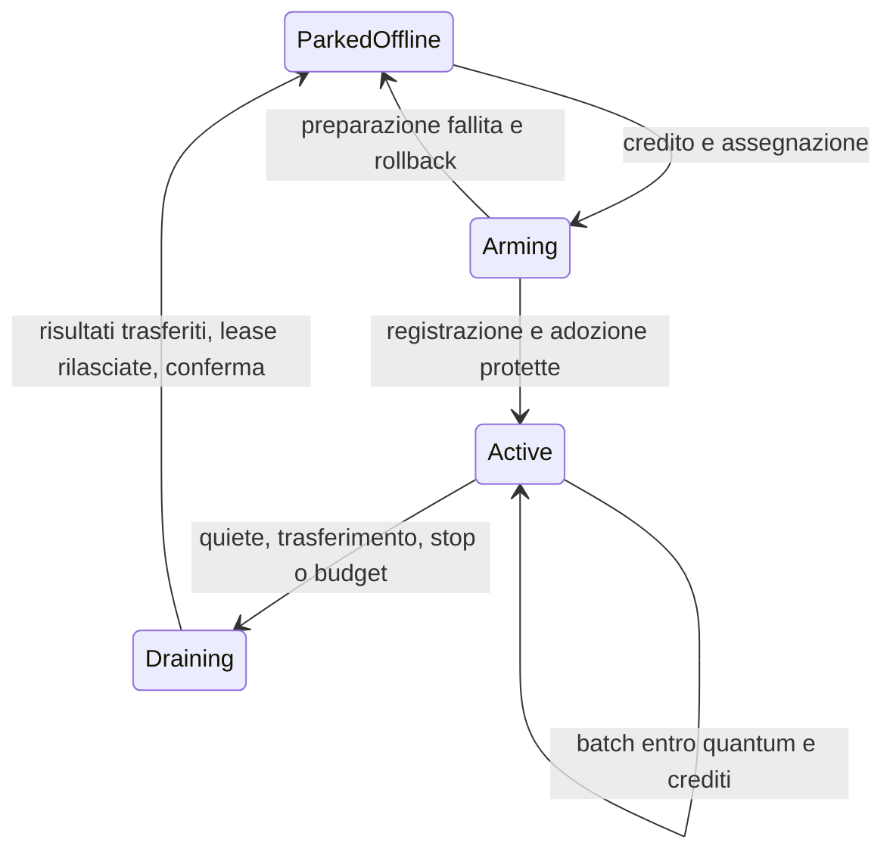

# Governo adattivo della capacità di lettura

**Piano proposto, 2026-11-21. Nessuna parte del controller o degli helper è implementata.**
La [ADR 0049](../adr/0049-adaptive-read-capacity.md) propone il contratto futuro.
Il gate `GATE-ADAPTIVE-READERS` resta `SPECIFICATA`, i requisiti sono in bozza e
HAZ-045/046/047 rimangono aperti. Le verifiche di questo documento controllano il piano,
non la correttezza o le prestazioni di un runtime futuro.
L'[analisi matematica](adaptive-read-model.md) separa gli invarianti astratti dalle garanzie
ancora mancanti: il controllo a soglie non ha una prova di stabilità globale o di ottimalità.

## 1. Obiettivo e perimetro

Usare tutta la capacità **utile e disponibile** per servire letture quando esiste domanda.
La soglia qualificata anticipa l'espansione di uno shard caldo; il candidato iniziale è 65%,
da confrontare anche con l'esempio originario del 70%. Non è un limite al carico totale
del processo. A domanda bassa gli helper si parcheggiano. A domanda alta
si può impiegare l'intero budget qualificato, conservando i limiti di memoria e di lavoro.
Non si genera lavoro artificiale per mantenere la CPU al 100% e non si promette di
servire un'offerta superiore alla capacità fisica o seriale del sistema.

Proteggere l'investimento significa valorizzare CPU, memoria e capacità già acquistate e
conservare dati, client e contratti durante l'evoluzione. Si misura il lavoro utile ottenuto
per risorsa consumata, insieme alla latenza e alla capacità sotto picco. Un helper che aumenta
solo occupazione CPU o traffico fra core non dimostra un beneficio. La necessità di ulteriore
hardware va motivata identificando il limite residuo, non dedotta da un solo shard saturo.

Prima realizzazione: GET volatili, con un solo Writer autorevole per shard, un Reactor
proprietario delle connessioni e un pool condiviso di helper di lettura. Gli helper possono
leggere la stessa chiave sulla stessa generazione immutabile. Non cambiano proprietario
delle chiavi, routing epoch, persistenza v1, wire v2 o politiche di retry. Durable resident,
cold I/O e cambio del numero di shard richiedono qualifiche successive e separate.

Il sistema operativo assegna i thread ai core; il controller governa il lavoro simultaneo
del processo. Un thread in più non garantisce un core fisico esclusivo né capacità in più.
Il progetto conserva un solo runtime ufficiale; gli helper estendono il suo dominio di
lettura e non costituiscono un secondo Store o un percorso di ricerca su shard estranei.

## 2. Che cosa significa capacità

Definire `C_s(k, p)` come la capacità sostenibile dello shard `s`, con `k` helper oltre al
Reader principale, per un profilo `p`. Il profilo identifica dimensioni dei valori, hit/miss,
dataset, distribuzione, hardware, build, quota CPU e concorrenza sugli altri shard.
La capacità è il tasso di GET validati completati con coda stabile e obiettivo di latenza
rispettato per un intervallo sostenuto. Un picco di throughput non basta.

Per workload omogenei, `rho_s(k) = domanda_s / C_s(k, p)`. La domanda usa ingressi osservabili
e lavoro pronto arretrato, non soltanto risposte completate: queste ultime si fermano proprio
quando il server è saturo. Il backlog non va contato due volte nella stima. Per mix di valori
usare costi di servizio per classe, in CPU-ns e byte, e una curva qualificata per il mix;
non sommare GET da 64 B e da 1 MiB come lavori equivalenti. I costi stimati e l'incertezza
devono essere esportati, non nascosti dietro un unico numero di operazioni al secondo.

La capacità non si apprende dal throughput osservato sotto carico leggero: mancherebbe
la domanda necessaria a mostrarla. Si parte da campagne controllate e curve `C_s(0..k, p)`;
la telemetria corrente verifica compatibilità del profilo e deriva della macchina.
`C_s(k+1, p)` non è assunto pari a una moltiplicazione lineare di `C_s(0, p)`.
Code, sincronizzazione, Reactor, rete e banda memoria possono annullare il guadagno.
Le curve per shard sono sezioni di una capacità congiunta: un helper assegnato a un owner
può modificare il servizio degli altri. L'arbitro non deve sommare capacità isolate come
se fossero indipendenti; anche questa interazione deve essere identificata in R0/R3.

Stati della stima: `unknown`, `qualified`, `stale`. Campioni insufficienti, clock non validi,
cambio di mix o quota e forte deriva rendono la stima sconosciuta o superata. Zero capacità
non può diventare un divisore. In questo caso si mantiene il percorso corrente e si espone
il motivo; eventuali prove con un helper richiedono un modo sperimentale esplicito e limitato.
All'avvio una stima sconosciuta mantiene zero helper. Se diventa stale durante l'uso,
si bloccano nuove espansioni e si drena verso il numero qualificato dal profilo conservativo
ancora applicabile, oppure verso zero. Il cambio non annulla task già ammessi. Il costo del
rientro e l'eventuale capacità insufficiente devono essere visibili.

Le misure [finite per owner](../../engineering/evidence/owner-capacity-local-2026-11-21/README.md)
e il [confronto sulle copie](../../engineering/evidence/hot-reader-copy-local-2026-11-21/README.md)
sono ricognizioni utili. Non qualificano ancora `C_s(k, p)` o le soglie del controller.

## 3. Osservazione prima dell'attuazione

Ogni Reader osserva localmente lavoro pronto, richieste completate, byte, CPU di lookup/CRC/
codifica, CPU di rete, tempi in coda, blocchi sull'output e barriere di visibilità. Gli helper
aggiungono le stesse misure per batch. Le attese, il parcheggio e il tempo deschedulato non
sono CPU di lettura. La sola percentuale CPU complessiva dello shard non identifica il limite.

| Condizione osservata | Decisione del governo |
| --- | --- |
| Letture delegabili, pressione persistente, beneficio parallelo qualificato | Richiedere un helper |
| Output bloccato da client lento o rete satura | Conservare backpressure e crediti; nessuna espansione causata da quel blocco |
| Attesa di una pubblicazione del Writer | Rispettare la barriera; non inviare letture su una versione precedente |
| Cold I/O | Conservare il percorso esistente; non classificarlo come CPU GET disponibile |
| Reactor seriale o banda memoria già limitanti | Segnalare il limite; arrestare espansioni senza beneficio |
| Quota CPU ridotta o macchina contesa | Ridurre il budget obiettivo, senza annullare lavoro già ammesso |
| Stima sconosciuta o telemetria insufficiente | Nessuna decisione automatica basata su capacità inventata |

Contatori e istogrammi sono limitati per shard/helper/classe, senza cardinalità per chiave o
client. Il percorso GET non aggiorna un contatore globale conteso: si pubblicano istantanee
per batch/turno. Un coordinatore raccoglie i dati fuori dal percorso ordinario. Non si introduce
un timer di sistema per ogni GET se il costo della misura non è già qualificato.

## 4. Due livelli di governo

**Governatore dello shard:** valuta pressione, lavoro realmente delegabile e punto utile della
curva di capacità. Produce una richiesta di risorse; non crea autonomamente thread.

**Arbitro globale:** assegna helper dal pool, considera tutti gli shard e conserva budget,
equità e isteresi. L'ammissione di nuovi helper resta serializzata da un unico protocollo di
crediti; le letture continuano sulle corsie locali. Il pool si predispone all'avvio e parcheggia
i thread inutilizzati, evitando creazioni/distruzioni nel picco di carico.

Separare questi limiti:

- `H_cap`: massimo rigido, configurato e verificato, di helper contemporaneamente impegnati.
- `H_target(t)`: obiettivo dinamico, entro `H_cap`, ricavato dal budget CPU disponibile al processo.
- Crediti di task, completamento, output e memoria: limiti rigidi distinti dal numero di thread.

Nel conteggio impegnato entrano `arming`, `active` e `draining`. Un helper in drain conserva il
credito fino alla conclusione del passaggio di proprietà. Una diminuzione di `H_target` può
lasciare temporaneamente più helper impegnati del nuovo obiettivo: si vietano nuove assegnazioni
e si drena l'eccesso. Non si dichiara falsamente che tale ritiro sia istantaneo. `H_cap` e i
limiti di memoria non si superano mai.

Il budget usa CPU/quota effettivamente accessibili e costi osservati di Reader principali,
Writer, flush, compaction e sistema. Un Writer parcheggiato non occupa un core riservato:
la sua capacità può essere usata temporaneamente dagli helper. Quando riparte, il governo
riduce i permessi di lettura aggiuntivi. Non si sottrae per sempre un core inattivo per ogni
Writer configurato, né si assume che ogni CPU logica abbia la stessa capacità. Dove la quota
non è rilevabile in modo affidabile serve un limite operatore conservativo e dichiarato.
`H_target` è una stima di governo, non una prenotazione di CPU presso il sistema operativo.

## 5. Soglie candidate e taratura

Questi valori sono **ipotesi per la prima campagna**, non configurazione già supportata o
valori accettati per rilascio. Lo SLO di latenza e i limiti di memoria vanno dichiarati prima
della campagna; non si ricavano dai risultati dopo averli osservati.

| Parametro | Ipotesi iniziale |
| --- | --- |
| Finestra di osservazione del controllo | Candidato 50 ms, aggregato con stima smussata e qualità dei campioni |
| Richiesta di espansione | Candidato 65% per 2 finestre valide, con lavoro delegabile; soglia finale qualificata per profilo |
| Incremento | Un helper per decisione, entro i crediti globali e la curva qualificata |
| Verifica del beneficio | Dopo assestamento, su CPU utile, goodput, latenza e costo per lettura; niente crescite cieche |
| Ritiro per scarso carico | Candidato 45% previsto senza quell'helper per almeno 5 s; banda allargabile verso il basso per rumore e ritardi |
| Permanenza minima prima di trasferimento ordinario | 500 ms, salvo stop o pressione sulle risorse |
| Dimensioni di batch | Limiti separati su richieste, byte e lavoro CPU; da qualificare prima dell'abilitazione |

La pressione comprende `rho_s(k)` e segnali di coda/CPU di lettura. Servono campioni sufficienti;
un percentile di poche risposte non autorizza una decisione. La soglia non forza un helper senza
lavoro delegabile e non supera i limiti globali. L'arbitro cerca il minimo `k` qualificato che
riporti la pressione sotto soglia. Con domanda crescente può usare tutti i permessi disponibili.
Superare la soglia produce una richiesta, non un'attivazione incondizionata: l'arbitro verifica
anche il beneficio attuale o il margine di picco dichiarato e il costo ammesso.

Il 65% è un candidato più anticipato del 70%, non una soglia dimostrata migliore. R0/R3 devono
misurare l'inizio della crescita persistente di coda/latenza, chiamato `rho_knee`, e il tempo
`T_act` fra osservazione e primo risultato utile dell'helper. `T_act` include conferme,
arbitraggio, risveglio, registrazione e avviamento. Una taratura candidata è

```text
theta_up[k] = rho_knee[k] - m_signal[k] - m_lead[k]
m_lead[k] = max(0, crescita_domanda) * T_act / C_s(k,p)
```

I margini sono adimensionali, nelle stesse unità di domanda e capacità; `m_signal` copre
l'incertezza del segnale. Non si sottrae due volte lo stesso margine usando anche una previsione
già corretta per quel rumore o ritardo. La prima griglia confronta 55/60/65/70/75%: un valore
esterno richiede nuova qualifica, non viene forzato nell'intervallo mediante un clamp.

Per il ritiro, il candidato 45% vale solo se la banda è sufficiente. Con errore del rapporto
limitato da `e`, variazione del rapporto vero nel confronto limitata da `d` e margine positivo
`delta`, una taratura della banda richiede

```text
gap[k] = max(0.20, 2*e[k] + d[k] + delta[k])
theta_down[k+1 -> k] = min(0.45, theta_up[k] - gap[k])
```

Se manca un valore positivo utile di ritiro o mancano stime affidabili, non si inventa una
banda sicura: si applica la gestione unknown/stale. Margini statistici danno una regola di
taratura, non una prova deterministica. Soglie e curva sono congelate per revisione qualificata;
un cambio azzera le conferme pendenti. Il controller non sposta le soglie a ogni finestra.
Ogni coppia di livelli usa la stessa curva e revisione: il ritiro da `k+1` confronta la
domanda con `C_s(k,p)` e con la banda dell'espansione da `k`, non con la soglia corrente
di un diverso livello. Così una taratura diversa per numero di helper non rompe l'isteresi.

Le due finestre candidate richiedono almeno 100 ms di osservazioni valide e non sovrapposte.
Dopo un'assegnazione, le conferme per un altro incremento ripartono da finestre successive al
primo lavoro utile e all'assestamento qualificato. Un p99 misurato del risveglio non è un limite
assoluto. Si cerca una risposta più rapida dei precedenti 300 ms di conferma; nessuno dei due
valori è ancora una prestazione dimostrata o un SLO garantito.

Il ritiro valuta `C_s(k-1, p)`, la capacità **senza** l'helper. Esempio illustrativo:
`C_s(0)=1 M GET/s`, domanda `0,70 M`, `C_s(1)=2 M`. Il carico corrente scende al 35%, ma
senza helper tornerebbe al 70%. Ritirarlo sotto il 45% corrente farebbe ricominciare il ciclo;
il rapporto controfattuale mantiene invece l'helper. Questi numeri non assumono scaling lineare reale.

Il controllo periodico non garantisce latenze di pochi microsecondi durante un gradino improvviso.
Un evento di backlog, deduplicato e limitato per shard, può svegliare rapidamente un helper già
assegnato o l'arbitro. Non può creare thread, prestare permessi impegnati o aggirare registrazione
e guardie di assegnazione. Risveglio, assestamento e sovraelongazione vanno misurati.

La politica iniziale rimane una macchina a stati con isteresi. PID e apprendimento automatico
sono fuori dal primo passo: mancano ancora curva dell'impianto, ritardi e qualità dei segnali.

## 6. Equità e uso del budget

Con pesi iniziali uguali, gli shard che richiedono aiuto ricevono prima il primo helper, poi
gli incrementi ulteriori. Crediti di tempo CPU e anzianità delle richieste evitano che uno shard
o un flusso di GET piccoli monopolizzi il pool. L'equità riguarda risorse e opportunità di servizio,
non lo stesso numero di GET per workload di costo diverso.
La proposta per R1 è un deficit round robin in unità di costo CPU, con pesi positivi e
cursore persistente. Il vantaggio del primo helper e i rinnovi devono rispettare tale
avanzamento; l'anzianità nominale da sola non costituisce una prova di assenza di starvation.

Se un solo shard ha domanda, può usare tutto il budget utile; non si mantengono quote inattive
per shard senza lavoro. Con quattro helper e due shard che ne chiedono rispettivamente quattro
e uno, un obiettivo iniziale ragionevole è tre più uno. Se il secondo smette di richiederlo,
il credito torna disponibile al primo. Il trasferimento avviene dopo drain, mai con doppia proprietà.

L'aggiunta o il rinnovo di una lease di assegnazione deve rispettare l'equità. Quando il budget
è tutto occupato e compare un altro shard caldo, il governo può richiedere un trasferimento
alla fine del quantum, anche se lo shard precedente resta sotto pressione. Questa è una decisione
di equità, distinta dal ritiro per basso carico; non promette SLO simultanei quando la capacità
totale è insufficiente. I Reader principali e i Writer devono conservare possibilità di progresso.

Il sistema è conservativo sul lavoro: con backlog qualificato e permessi realmente liberi non
lascia volontariamente helper parcheggiati oltre il tempo di reazione dichiarato. Se mancano
crediti, beneficio, profilo o risorse, esporta la causa. Una CPU al 100% con goodput fermo non
è un successo del governo. Ogni espansione deve avere un beneficio superiore all'incertezza
misurata e restare entro SLO e budget memoria; altrimenti si arresta l'espansione e si drena
la prova inefficace. Non si assume che `C_s(k)` sia sempre crescente.
Un punto di parallelismo senza beneficio rimane escluso per quel profilo fino a una nuova
calibrazione o a un cambiamento sostanziale verificato. Non si ripete la stessa prova ogni
finestra. Questa memoria delle decisioni ha cardinalità limitata, senza etichette client arbitrarie.
Distinguere assenza di guadagno nella capacità qualificata da scarsa utilità al carico corrente.
Un helper superfluo a domanda bassa non invalida la sua curva di capacità sotto picco: il
holdoff operativo include il regime di domanda e si rivaluta solo per crescita o pressione
sostanzialmente diverse. Non si perde capacità futura per un giudizio tratto a carico leggero.

| Caso di controllo | Esito atteso del modello |
| --- | --- |
| Nessuna domanda, budget disponibile | Helper offline; nessun lavoro sintetico |
| Domanda al 75% di `C_s(0)`, helper efficace e budget libero | Aggiunta progressiva; il calo della pressione corrente non provoca subito il ritiro |
| Quattro permessi, due owner che ne chiedono quattro e uno | Obiettivo tre più uno dopo drain; nessuna quota inattiva quando manca il secondo owner |
| `H_target` passa da quattro a uno mentre quattro crediti sono impegnati | Nessuna nuova concessione; drain dell'eccesso, crediti restituiti solo dopo conferma |
| Coda causata da output bloccato e poca CPU GET | Nessun aumento causato da quella coda |
| Il primo helper non aumenta capacità utile | Ritiro della prova e blocco di ulteriori tentativi equivalenti sul profilo |

Questi sono controlli ragionati della proposta, non test automatici già eseguiti sul controller.

## 7. Dominio di lettura e ciclo di vita degli helper

Il daemon attuale usa il fronte `reader_safe_epoch`; la reclamation con `reader_epoch_lease`
non è automaticamente protetta dal contatore usato per le lease dei lettori embedded
([implementazione](../../src/store/paired/lane_publication.cpp)). Riutilizzare quel contatore
senza modificare e provare il protocollo del daemon sarebbe scorretto.

Il nuovo dominio deve includere il Reader principale e tutti gli helper registrati. Ogni
generazione resta viva finché è protetta da almeno una lettura, operazione asincrona o passaggio
di proprietà. Registrazione, adozione, ritiro e riuso degli slot richiedono un argomento esplicito
sull'ordine di memoria e test dei casi concorrenti. Non basta aggiungere un minimo di epoche
senza chiudere la gara tra caricamento del puntatore e registrazione del lettore.

I requisiti critici esistenti `GS-CONCUR-PAIR-001` e `GS-CONCUR-MEM-001` restano vincolanti.
Prima di R2 occorre estenderne autorità e prove alla proposta accettata; le prove attuali
non dimostrano il nuovo handoff. Il piano non introduce un requisito critico senza prove
né usa questo documento come sostituto di una verifica di lifetime.



Un helper appartiene a un solo owner per assegnazione. Input e completamenti possono usare
corsie SPSC per assegnazione, mantenendo un solo produttore e consumatore; non si introduce
una coda globale contesa per ogni GET. Un cambio owner richiede corsie drenate, conferma del
Reader precedente e un identificativo di assegnazione nuovo. I completamenti vecchi non
devono raggiungere il nuovo owner o riaprire una connessione chiusa.

Prima di usare una generazione su un altro thread serve un handoff protetto: la protezione
del Reader mittente termina soltanto dopo l'acquisizione di quella del destinatario, oppure
si trasferisce un pin autorevole esplicitamente supportato. `RecordRef` e span da soli non
costituiscono una protezione. Parcheggio e riuso avvengono solo dopo quiescenza reale. Il
modello è coerente con la distinzione tra lettore attivo e offline di
[Userspace RCU QSBR](https://github.com/urcu/userspace-rcu/blob/master/doc/examples/urcu-flavors/qsbr.c).

## 8. Richieste, memoria e risultati

Il Reactor conserva socket, binding dell'owner, parsing, sequenza delle risposte e barriere
PUT/ERASE → GET. Le richieste delegate possiedono chiave e metadati limitati; non prendono in
prestito il buffer di input che il Reactor potrà compattare. Ogni GET deve usare una generazione
ammessa dalla barriera di visibilità della connessione. Una finestra di GET delegati mantiene
l'ordine e si drena prima di operazioni che costituiscono una barriera, come nel modello attuale
delle finestre asincrone. Gli helper non eseguono mutazioni o TTL reclaim.

Prima dell'invio si riservano task, posto di completamento, memoria e credito di output.
Il payload di un GET non dichiara la dimensione della risposta: questo va gestito senza una
prenotazione illimitata, un doppio lookup obbligatorio sul Reactor o nuovi rifiuti dei valori grandi.
Il primo prototipo deve confrontare budget conservativi per batch e una continuazione tipizzata
per risposte oltre la capacità del batch. Una continuazione conserva la selezione e una lease
di generazione trasferibile, non uno span senza proprietario o una nuova lettura su un'altra
versione. Questa parte è un vincolo bloccante prima dell'abilitazione, non un dettaglio rinviabile.

I completamenti ordinari contengono frame o byte proprietari pronti all'output. Il pin può allora
essere rilasciato prima che un client lento finisca di ricevere. Se una continuazione conserva
ancora una generazione, il suo credito e la protezione restano contabilizzati fino al consumo o
alla cancellazione sicura. Nessuna sospensione deve nascondere generazioni o byte non conteggiati.

Code helper piene, campioni mancanti o risorse di espansione negate mantengono il percorso
primario e la backpressure esistente; non creano da sole nuovi `OVERLOADED`, rerouting o retry.
Un helper già ammesso ha sempre un credito di completamento: non può perdere un risultato
per una coda piena. La cancellazione di una connessione non libera oggetti ancora letti da un
helper. L'output resta soggetto agli stessi limiti e controlli di identità del percorso corrente.
Un quantum CPU è controllabile fra lavori, non è una preemption istantanea dentro una decodifica
o un CRC grande. Lavori oltre il budget del batch richiedono il percorso di continuazione
qualificato; il massimo ritardo di drain sotto valori grandi e descheduling va misurato.

Allo stop si chiudono nuove deleghe, si drenano/cancellano in sicurezza i task, si consumano
i completamenti e si portano offline i lettori, mantenendo vivi i destinatari necessari al drain.
Gli helper vanno uniti prima di distruggere generazioni e Store. Disabilitare il controller a
caldo significa passare per questo drain, non cambiare modalità mentre esistono borrow pendenti.
HAZ-044 resta distinto: il controller non reinterpreta i conflitti di compaction o le mutation outcome.

## 9. Telemetria del governo

Esportare, con unità e popolazioni esplicite: qualità/età del profilo, domanda osservabile,
backlog pronto e bloccato, `rho`, CPU per fase, goodput, latenza di coda e totale, byte,
helper per stato, crediti rigidi e budget obiettivo, generazioni e byte trattenuti, risvegli,
tempo di assestamento, trasferimenti e richieste di aiuto non soddisfatte con motivo.
Registrare decisioni e causa in un registro limitato; non un log per ogni GET.

Per verificare il valore dell'investimento, conservare CPU-ns di lettura per milione di GET
utili, CPU totale del processo sullo stesso workload, memoria del pool/output, byte trattenuti
e costo di risvegli, controllo e drain. Dichiarare l'attribuzione dei costi condivisi con i Writer.
Le code non completate e i rifiuti restano visibili: non abbassano artificialmente il costo medio.
L'energia viene riportata soltanto se misurabile affidabilmente; CPU occupata non equivale a
watt misurati. Non si deducono costi monetari o ritorni economici da una sola percentuale CPU.

La qualifica confronta percorso primario, numero fisso di helper qualificato e governo adattivo,
su carico basso, picco e ritorno alla quiete. Un helper deve aumentare il goodput utile o
proteggere uno SLO/margine di picco dichiarato entro un budget di costo esplicito. Quando la
domanda è già servita nello SLO, si preferisce la soluzione con minori risorse. A domanda
insoddisfatta si usa altro budget solo se porta beneficio marginale; non si riempiono i core
per rappresentare una percentuale di efficienza. Anche le previsioni di crescita non avverate
e il costo della capacità predisposta vanno conservati. Se il confronto non giustifica
complessità e costo operativo aggiuntivi, il piano si arresta prima dell'abilitazione.

Il piano misura anche il costo dell'osservatore. Se contatori o controllo consumano il guadagno,
la politica non è qualificata. L'uso di segnali locali di risorse segue un criterio analogo a
[Google SRE](https://sre.google/sre-book/handling-overload/), senza introdurne politiche di rifiuto.
La scelta di finestre e verifica della latenza trae spunto dal
[controllo adattivo di Envoy](https://www.envoyproxy.io/docs/envoy/latest/configuration/http/http_filters/adaptive_concurrency_filter).
Non se ne importano riduzioni di concorrenza per calibrazione, errori aggiuntivi o retry automatici.

## 10. Ordine di realizzazione

| Fase | Risultato da produrre | Condizione di passaggio |
| --- | --- | --- |
| R0 — osservazione | Telemetria e carico sostenuto a offerta controllata, helper disabilitati | Capacità primaria qualificata per profilo e costo dell'osservatore misurato |
| R1 — modello di controllo | Arbitro in simulazione e in osservazione, senza attuazione | Invarianti di budget, equità, isteresi e segnali incompleti provate con clock finto |
| R2 — sicurezza multilettore | Registro/lease, handoff, drain e prototipo helper a numero fissato | ADR accettata, argomento di memoria, sanitizer, fault e prove di visibilità riusciti |
| R3 — curve parallele | Misure con 0/1/2/4 helper, nei limiti della macchina | Beneficio marginale e costi di code/output qualificati, compresi valori grandi |
| R4 — attuazione adattiva | Espansione a soglia qualificata, equità e ritiro controfattuale | Burst, soglie e budget variabili rispettano criteri dichiarati; disabilitazione provata |
| R5 — piattaforme e durata | Campagne sostenute e native per le righe dichiarate | Evidenza conservata per piattaforma; nessuna promozione da una sola prova locale |

R1 può preparare l'arbitro usando dati R0; non consente di abilitare helper prima di R2/R3.
R0 è il prossimo passo concreto. Tutte le fasi sono ancora da implementare; questa pianificazione
non crea configurazioni CLI, metriche, thread o supporto multilettore nel prodotto corrente.

## 11. Matrice minima delle prove future

Carichi: bilanciato, 75/90% di offerta su un owner, singola chiave letta, diversi shard caldi,
mix di costi e richieste non delegabili, miss/TTL/tombstone; valori 64 B, 1/4 KiB e attorno alle
soglie scatter e ai limiti del record. Campagne di capacità iniziali con sola lettura; prove di
lifetime e visibilità anche con PUT/ERASE, merge, rotazione e compaction concorrenti.

Usare un generatore a offerta controllata con tempo di arrivo pianificato, conti di richieste
offerte/inviate/completate e mancate ammissioni espliciti, oltre alla latenza dal momento previsto.
Un generatore che non mantiene il ritmo o nasconde ritardi non qualifica il server. Conservare
limiti su durata, operazioni, memoria e dataset, senza code illimitate nel generatore. Partire da
finestre stazionarie di almeno 30 s e almeno sette ripetizioni per cella, con sweep attorno a
50/70/85/100/120% della capacità stimata; il protocollo finale va fissato prima delle misure.
Un client remoto o risorse CPU separate evitano la competizione del precedente loopback; se non
possibile si dichiara la contesa e la riga non diventa una capacità isolata del server.

Le prove del controller devono includere: carico oscillante attorno alla soglia qualificata, riduzione di budget
mentre esistono drain, pressione attuale bassa ma controfattuale alta, saturazione simultanea di
più owner, starvation, pool completo, nessun helper utile, telemetria assente/stale, clock e
contatori anomali, risveglio del Writer e client lenti. Le prove del runtime devono esplorare
registrazione contro reclaim, ABA degli slot, errore di allocazione, completamenti fuori ordine,
chiusura di connessione, perdita di un helper e shutdown con generazioni ancora protette.

L'accettazione richiede risposte e outcome corretti, limiti rigidi rispettati, progresso di Writer
e shard fratelli, SLO e criterio di guadagno marginale prefissati, costi di memoria/CPU/risveglio
conservati e un modo di disabilitazione verificato. Le soglie candidate e il 100% del budget disponibile
sono obiettivi di governo da validare, non percentuali di efficienza già dimostrate.
